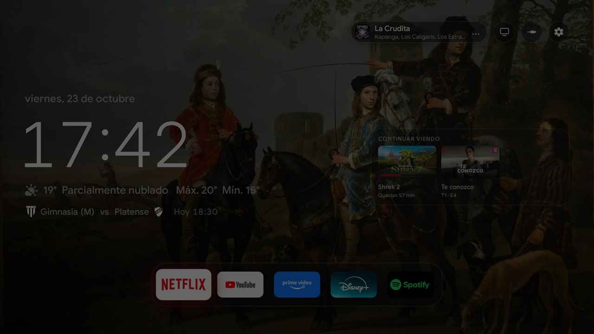
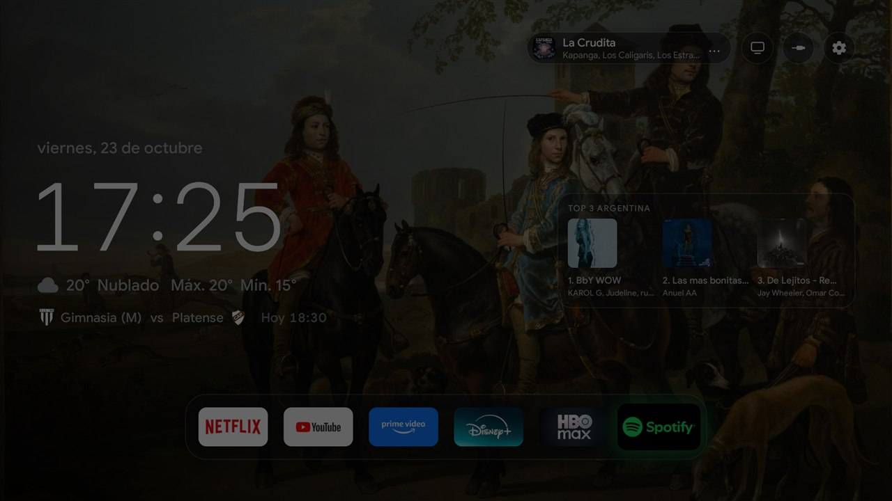
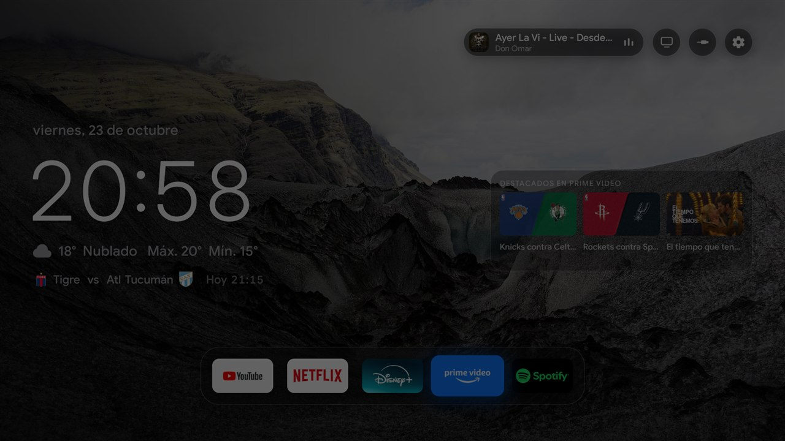
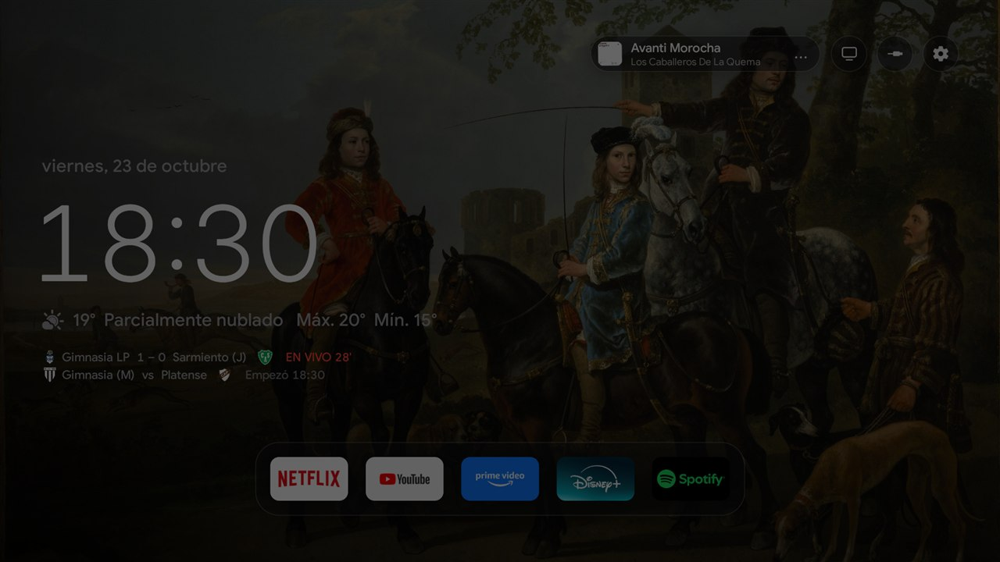
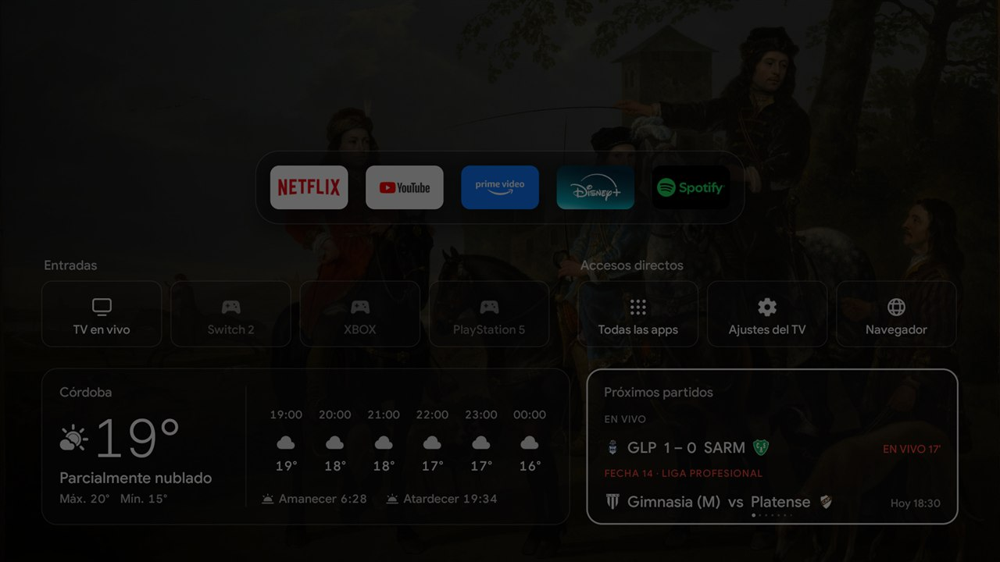
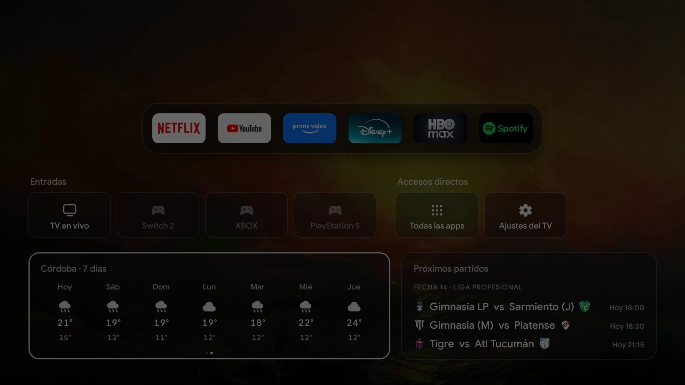
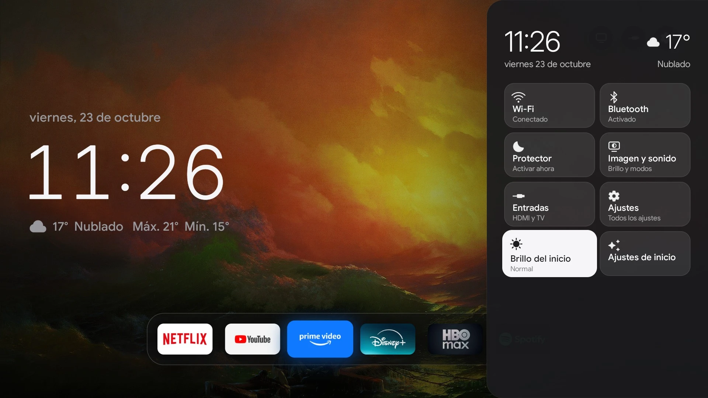
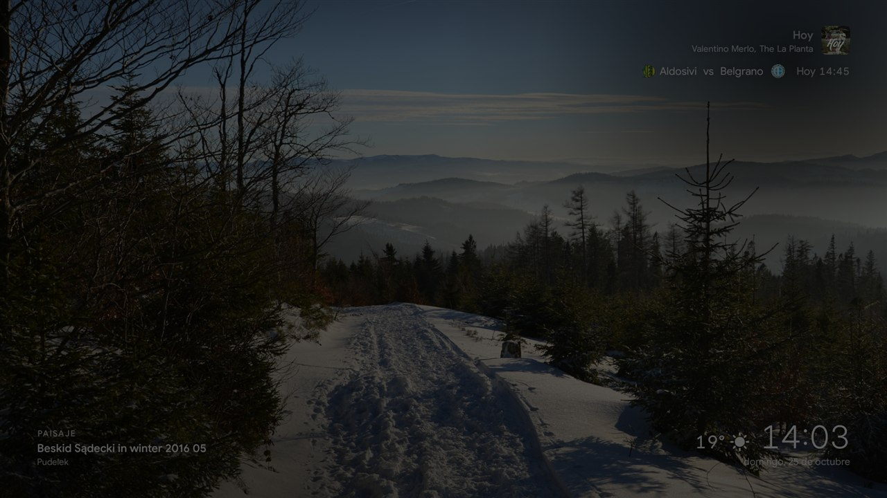

# Cambios de este fork

Todo lo que se agregó o cambió sobre [Free My TV](https://github.com/simbasjungles/free-my-tv), pensado para una
**TCL Google TV de 2 GB** (Android 11, GPU Mali-G31) en Argentina. Lo probado, en esa tele.

| | |
|---|---|
|  |  |
| "Continuar viendo" en Netflix | Top 3 Argentina en Spotify |
|  |  |
| Destacados de Prime Video, con fondo de paisaje | Dos partidos en vivo y el reproductor |
|  |  |
| El cajón, con "Navegador" y los partidos | El pronóstico extendido de 7 días |
|  |  |
| El panel rápido | El protector de pantalla |

Capturas sacadas en la tele (con el brillo del inicio bajado).

## Pantalla de inicio

- **Isla "Continuar viendo"** (a la derecha, entre los botones de arriba y el estante): muestra el contenido de la app
  del estante que tenés seleccionada, 0,2 s después de quedarte en ella (si pasás rápido no parpadea).
  - **Disney+ y Netflix:** las últimas 3 cosas para seguir viendo, con imagen, temporada · episodio, barra de progreso
    del color de la app y "Quedan N min" en las películas. No muestra lo que está visto en más de un 95 %. Abre directo
    en ese episodio.
  - **YouTube:** los últimos videos reproducidos en esta tele (la app guarda su propio historial de 20 por app, porque
    YouTube no lo comparte). Si hay menos de 3, se completa con **Tendencias**, que abren el video directo.
  - **Spotify:** el **Top 3 de Argentina**, tema por tema, con la portada de cada disco (sale del Top 50 Argentina
    público de Spotify, sin cuenta, y se actualiza cada 4 horas).
  - **Prime Video:** "Destacados en Prime Video" (Prime no publica qué estabas viendo, y como título de lo que suena
    manda solo "PrimeVideo").
  - Todas las apps tienen una isla del **mismo tamaño**. Se puede apagar en *Ajustes de inicio → Continuar viendo*.
  - Navegación: ↑ desde el estante entra a la isla, ← → recorre las tarjetas, OK abre, ↓ o Atrás vuelve.
- **Al volver al inicio no queda ninguna app seleccionada** (ni la isla a la vista). ↑ va directo a los botones de
  arriba; cualquier otra flecha u OK selecciona el estante.
- **Botón "Navegador"** en el cajón de abajo (junto a *Todas las apps* y *Ajustes del TV*): abre BrowseHere, que ya no
  aparece en *Todas las apps*.
- **Fondos de Wikimedia Commons** (imágenes destacadas, licencia libre): Paisajes, Arte, **Arte abstracto** (Kandinsky,
  Klee, Mondrian, Malevich, Delaunay, Kupka, Hilma af Klint, Jawlensky, Franz Marc, Popova), **Animales** (mamíferos,
  aves, reptiles, animales en vuelo) y Favoritas. Se eligen en *Ajustes de inicio → Fondos* y cambian solos cada tanto.
- **Temas de temporada** (*Ajustes de inicio → Fondos → Tema de temporada*), para activar en fechas puntuales:
  **Halloween** (decoraciones), **Navidad** (decoraciones navideñas), **Año Nuevo** (fuegos artificiales), **Carnaval**
  (Venecia y máscaras), **Pascuas** (huevos y decoraciones) y **Cumpleaños** (tortas). Mientras uno está activo, el fondo
  del inicio y las fotos del protector salen de ese tema (aunque el fondo esté en negro; el reloj del protector se
  respeta). Al volver a *Desactivado*, vuelve lo que tenías elegido.
- **Brillo del inicio** desde el panel rápido, con el atenuado del propio sistema (no le cuesta nada a la placa de video).
- **Pronóstico extendido de 7 días:** la tarjeta del clima del cajón tiene dos páginas, las próximas horas (con
  amanecer y atardecer) y la semana, con la máxima y la mínima de cada día. OK en la tarjeta y ← → para pasar de página;
  los puntitos de página se ven solo con la tarjeta seleccionada. Lo mismo para la tarjeta de partidos.
- Sin efectos de clima en el fondo (consumían demasiado).

## Reproductor ("Reproduciendo ahora")

- Botones de **anterior, reproducir/pausa, siguiente, detener, aleatorio y repetir** (aleatorio y repetir aparecen solo
  cuando la app los ofrece: Spotify, mientras suena una playlist o un disco).
- **Detener** se recuerda en el inicio y en el protector de pantalla hasta que vuelva a sonar algo (Spotify solo se
  pausa, y si no la canción reaparecía).
- Los videos de YouTube, Netflix y demás apps de video no aparecen en el reproductor (es para música).
- Ecualizador animado mientras suena; tres puntos quietos en pausa.

## Fútbol

- **Los partidos en vivo siempre primero:** 1 en vivo, se ve solo ese; 2 o 3, juntos uno debajo del otro; 4 o más, de a
  3 turnándose. Sin ninguno en vivo, se turnan los próximos (empiezan en menos de 3 h) y los que terminaron hace menos de
  una hora.
- Un partido que ya pasó su hora de inicio y todavía figura "por empezar" aparece como **"Empezó HH:MM"** hasta que llega
  el marcador (antes desaparecía), y mientras tanto se actualiza cada minuto.
- **Competiciones:** Liga Profesional, Copa de la Liga, Copa Argentina, Trofeo de Campeones, Supercopa Argentina,
  Supercopa Internacional, Libertadores, Sudamericana, Recopa, Eliminatorias Conmebol, Copa América, Mundial, Champions
  y Europa League.
- El **protector de pantalla** sigue la misma regla (se turnan cada minuto).
- En el cajón, solo el "EN VIVO" de cada partido va en rojo.

## Control remoto de TCL

Los botones que en modo Free My TV no hacían nada ahora funcionan (se cambian en *Free My TV → Botones del control*):

| Botón | Código | Abre |
|---|---|---|
| Netflix | 4062 | Netflix |
| YouTube | 190 (algunos controles: 4065) | YouTube |
| Prime Video | 4099 | Prime Video |
| Navegador | 4159 | BrowseHere |
| TV | 4001 | La TV en vivo, directo en los canales de antena |
| TCL Home | 4137 | Nada hasta que elijas una app |
| Engranaje | 4077 | El panel rápido |

**Sintonizador:** la app de TV de TCL, abierta sin más, vuelve a la última fuente (muchas veces un HDMI). Se le pide la
lista de canales de la entrada de antena, así abre en los canales. Detalles en `Prefs.java` y `HomeApps.liveTv`.

## Panel rápido

- Wi-Fi, Bluetooth, Protector de pantalla, Imagen y sonido, Entradas, Ajustes, Brillo del inicio, Ajustes de inicio y
  **Cambiar fondo** (OK: la siguiente imagen; mantener OK: la siguiente categoría).
- El clima arriba; se cierra deslizándose.

## Protector de pantalla

- Fotos de las mismas categorías que el fondo, o el reloj grande; la hora, el clima, la música y los partidos en las
  esquinas.
- Con el control: ↑ marca la foto como favorita, ↓ elige la categoría, → pasa a la siguiente.

## Encendido y apagado

- **Animación de apagado estilo Samsung:** dos barras negras que se cierran hacia el centro al apretar apagar, y se abren
  al prender.
- Transición de las apps con un fundido corto, sin la pantalla gris de carga; la TV en vivo y las entradas esperan a que
  el inicio termine de oscurecer.
- Sonidos de navegación nuevos (sintetizados, estilo Apple TV).

## Apps

- **Todas las apps** se vuelve a leer al abrirla y cuando se instala, desinstala, activa o desactiva una app (antes podía
  quedar vacía).
- Mantener OK en una app del estante → ↓ → **Reemplazar**: elegís desde *Todas las apps* la que va en su lugar.
- En *Todas las apps*, mantener OK → **Mover**: la llevás con las flechas a cualquier lugar.
- **YouTube Music queda activada:** el modo ya no la apaga, y la revisión del modo sigue solo la lista actual de apps a
  apagar (antes volvía a apagar lo que había apagado al principio).

## Cada cuánto cambia cada cosa

| Qué | Cada cuánto | Se cambia en |
|---|---|---|
| Fondo del inicio | **6 horas** (o 1 h, 12 h, 1 día, 1 semana) | *Ajustes de inicio → Fondos → Cambiar fondo cada*; *Cambiar fondo ahora* ahí o en el panel rápido |
| Fotos del protector de pantalla | **30 segundos** (o 15 s, 1 min, 5 min) | *Ajustes de inicio → Fondos → Cambiar foto cada*; → en el protector pasa a la siguiente |
| Listas de fotos de Wikimedia | Se renuevan **cada semana** (las imágenes se bajan al mostrarse; se guardan las últimas 40) | — |
| Clima | Cada **30 minutos** | — |
| Partidos | Cada **5 minutos**; **cada minuto** mientras hay uno en vivo o que ya empezó; la semana completa cada **3 horas** | — |
| Partidos debajo del reloj | Se turnan cada **12 segundos** (en el protector, cada minuto) | — |
| Isla "Continuar viendo" | Aparece **0,2 s** después de quedarte en una app; lo de Netflix y Disney+ se actualiza apenas la app lo publica | *Ajustes de inicio → Continuar viendo* |
| Top 3 Argentina (Spotify) | Cada **4 horas** | — |
| Historial de YouTube y Spotify | Guarda lo que suena más de **10 segundos**; hasta 20 por app | — |
| Reproductor en pausa | Queda a la vista **20 minutos**, después se va (o al tocar Detener) | — |

## Rendimiento

Medido en la tele, pasando por el estante con la isla a la vista:

- Cuadros trabados: **0,9 %**; cuadro típico **8 ms**, el peor **14 ms**.
- Volver al inicio desde una app: **0,3 s**.
- Memoria del inicio: **55–74 MB** en pantalla, **16 MB** en segundo plano, casi sin procesador.

- La isla tiene su propia capa: aparece y desaparece sin redibujar nada.
- Los datos de la isla se cargan 1,2 s después de volver al inicio, para no competir con la animación.
- Los logos del estante quedan en memoria (YouTube y Prime Video cambiaban de tamaño al volver).
- Al seleccionar un logo, sus dos versiones se funden en lugar de cambiar de golpe.
- **Compilar la app después de instalarla** (`cmd package compile -m speed -f io.freemytv`): recién instalada, el primer
  arranque tardaba 3 s.

## Para tu propia tele

- **`app/assets/local/apps.properties`** (ignorado por git): un nombre o una imagen de tarjeta propios para alguna app, o
  marcarla como app de video. Ver `LocalApps.java`.

## Notas sobre la TCL

- **Encendido instantáneo** (*Ajustes → Sistema → Energía*): activado, la tele queda en reposo con Wi-Fi (se prende con
  "OK Google" o Chromecast, sin led rojo). Desactivado, se apaga del todo (led rojo, tarda 20–30 s en prender).
- **HDMI-CEC con encendido automático:** los aparatos HDMI (consolas, barra de sonido por eARC) pueden despertar la tele.
- En reposo, la barra de sonido sigue conectada por Bluetooth: es cómo funciona el reposo de TCL.
