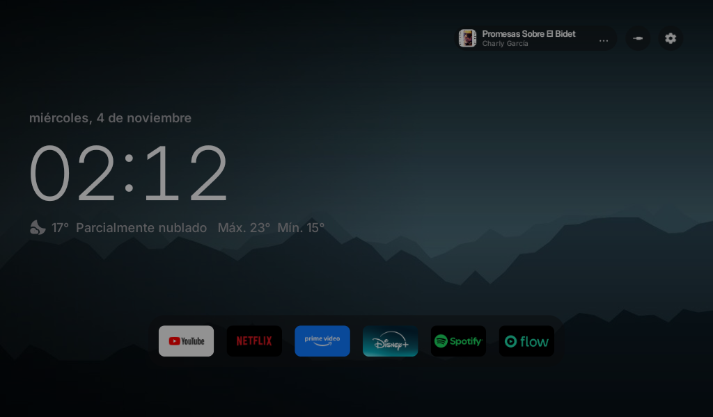
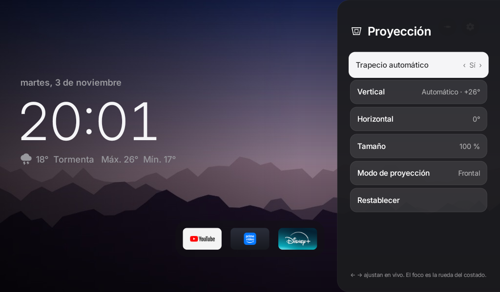
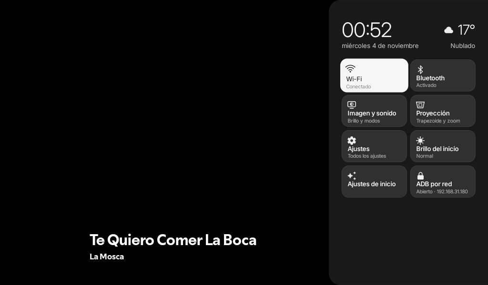
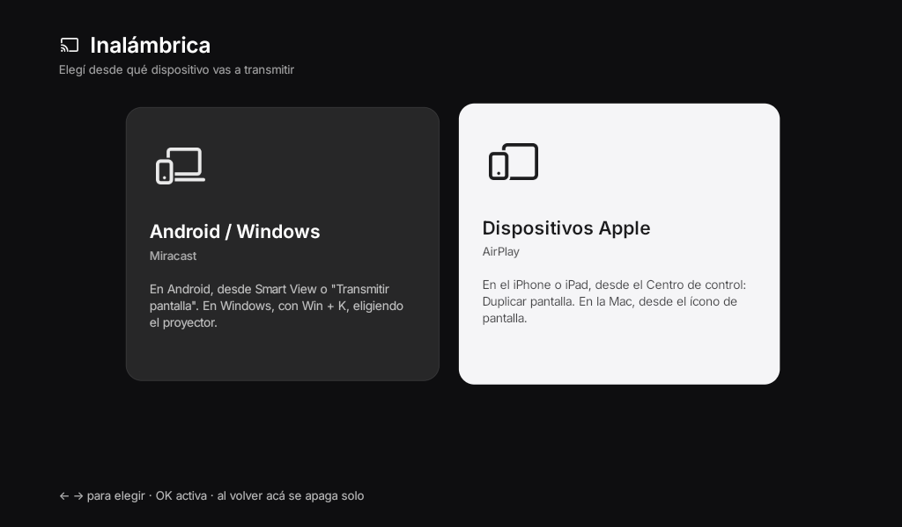
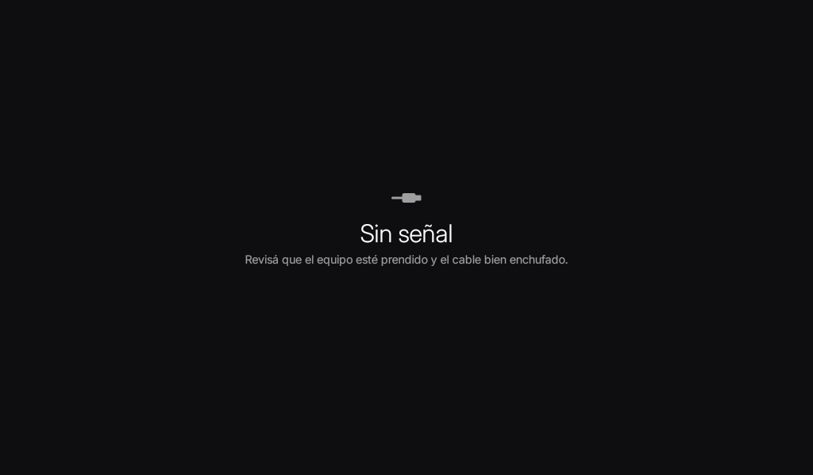
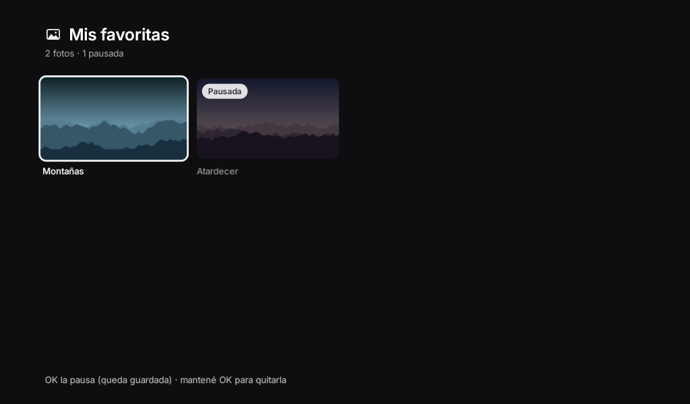
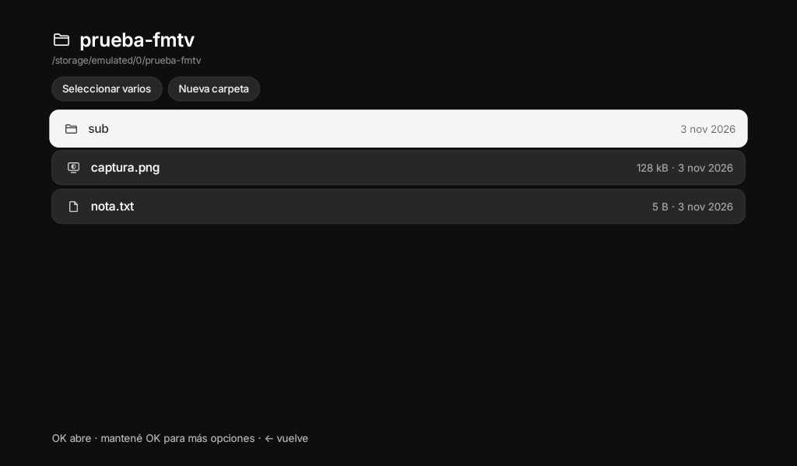
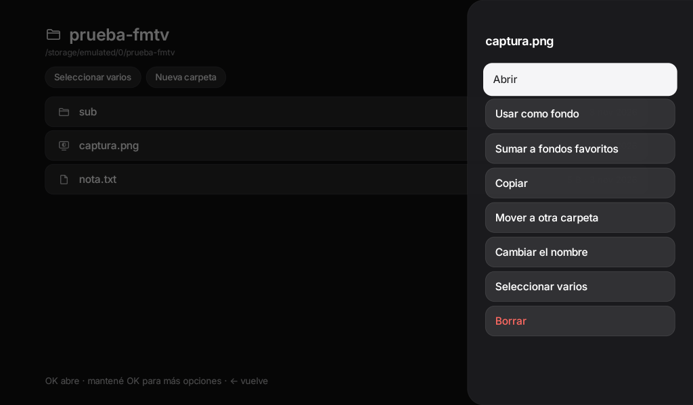

# Free My TV · Proyector

**Un inicio limpio y seguro para proyectores Android chinos, empezando por el HY300.**

Sin publicidad ni tiendas chinas, sin el instalador remoto del fabricante, con pantallas propias para la proyección,
el HDMI y la recepción inalámbrica. Código abierto. Un botón para volver a como vino.

[⚠️ Por qué](SEGURIDAD-HY300.md) · [Instalar con un asistente](PROMPT-PROYECTOR.md) · [Instalar a mano](apk/LEEME.md) · [Todo lo que se hizo](PROYECTOR.md)

> ⚠️ **El HY300 viene con un instalador remoto en el firmware.** En cada arranque baja órdenes de servidores en China y
> las corre como root. Además, trae el ADB abierto a toda la red y apps con permisos de micrófono, cámara e instalación
> dados de fábrica. Lo que encontramos y por qué reemplazamos esas apps: [SEGURIDAD-HY300.md](SEGURIDAD-HY300.md).

Es la rama `proyector` de [este fork](https://github.com/Argentinoman/freemytv-argentinoman) de
[Free My TV](https://github.com/simbasjungles/free-my-tv), recortada y adaptada para un proyector de 1 GB de RAM.

## Cómo se ve

Capturas sacadas en el HY300 (1024×600).

| | |
|---|---|
|  |  |
| El inicio | Proyección: trapecio automático, ángulos, tamaño y modo |
|  |  |
| El panel rápido | Inalámbrica: Miracast o AirPlay, prendidos solo mientras se usan |
|  |  |
| HDMI a pantalla completa, con "Sin señal" propio | Mis favoritas |
|  |  |
| El explorador de archivos | Mantener OK sobre una foto: usarla de fondo, copiar, mover… |

## Qué trae

- **Inicio sin publicidad:** las apps de streaming que usás en un estante, el reloj y el clima (con el pronóstico de 7
  días), y "Continuar viendo" de Netflix, Disney+, YouTube, Spotify, Prime Video y Flow.
- **Tus fotos de fondo:** las del sistema o las tuyas, con Mis favoritas (el orden que quieras, en orden o al azar).
  Mantener OK sobre una foto en el visor la deja de fondo.
- **Proyección:** trapecio automático con el sensor, ángulos a mano, tamaño y modo de proyección (frontal, trasera,
  techo).
- **HDMI** a pantalla completa, con "Sin señal" cuando no llega nada.
- **Inalámbrica:** Miracast para Android y Windows, y AirPlay para Apple. Cada uno se prende solo mientras lo usás.
- **Explorador de archivos y visor de fotos** propios, con el botón USB que abre el pendrive.
- **Netflix con las flechas:** la Netflix de celular, que es la única que anda en estos proyectores, manejada con el
  control.
- **Barra de volumen** fina, widget de música, panel rápido y animación de apagado.
- **Seguro y reversible:**
  - las apps del fabricante se apagan, no se desinstalan;
  - un firewall corta el ADB y los servidores del fabricante;
  - *Original* devuelve todo como estaba.

Probado en un **HY300**: Amlogic T950S, Android 13, 1 GB de RAM, pantalla de 1024×600, firmware
`be311-13 TQ2A.20250807`.

## Instalar

| Cómo | Qué necesitás |
|---|---|
| **Con un asistente** (Claude Code u otro): pegale [PROMPT-PROYECTOR.md](PROMPT-PROYECTOR.md) | Una computadora en la misma red que el proyector. Revisa tu firmware, guarda cómo estaba y te pregunta antes de apagar cada cosa, sobre todo apps de streaming o IPTV que uses. |
| **A mano, con el APK listo:** [apk/LEEME.md](apk/LEEME.md) | Un pendrive (solo el inicio), o una computadora con adb (también la parte de seguridad). |
| **Compilando el tuyo** | JDK 17 y el SDK de Android. `./build.sh` crea `config.properties`: tu ciudad y, si querés, tu clave de TMDB para las recomendaciones de películas. Ver [CLAUDE.md](CLAUDE.md). |

## Volver atrás

En el proyector: **Free My TV → Pantalla de inicio → Original**. Vuelven el inicio del fabricante y todo lo que se
apagó. Lo que se apagó a mano y el firewall se deshacen con los pasos de "Volver todo atrás" de cada guía.

## Otros proyectores

Las pantallas propias (Proyección, HDMI, Inalámbrica, volumen) se prenden solo en el HY300 (`ro.product.device` =
`t950s_be311`). En otro proyector Android el inicio anda igual, pero hay que leer qué trae antes de cambiar nada:
*Adaptarlo a otro proyector* en [CLAUDE.md](CLAUDE.md).

## Cómo funciona

- **Una app de Android común, sin Gradle ni librerías.** [`build.sh`](build.sh) arma un APK de menos de 2 MB.
- **Usa el ADB del propio proyector, desde adentro** (`127.0.0.1:5555`), para lo mismo que harías vos con una
  computadora: cambiar el inicio, apagar apps, ajustar el trapecio.
- **El firewall** ([`tools/proyector/agent.sh`](tools/proyector/agent.sh)) lo corre el firmware como root en cada
  arranque: deja ese ADB solo para Free My TV y el sistema.
- **Dibujado a mano en un solo Canvas**, pensado para la GPU Mali-450 y el 1 GB de RAM.
- **Red de seguridad:** si el inicio se cuelga tres veces en cinco minutos, vuelve solo el del fabricante.

| Archivo | Qué es |
|---|---|
| [`HomeView.java`](app/src/io/freemytv/HomeView.java) | El inicio |
| [`HomeMode.java`](app/src/io/freemytv/HomeMode.java) | El cambio entre Free My TV y Original, y qué apps apaga |
| [`Projector.java`](app/src/io/freemytv/Projector.java), [`ProjectionActivity.java`](app/src/io/freemytv/ProjectionActivity.java) | Trapecio y modo de proyección |
| [`HdmiActivity.java`](app/src/io/freemytv/HdmiActivity.java) | La entrada HDMI |
| [`WirelessActivity.java`](app/src/io/freemytv/WirelessActivity.java) | Miracast y AirPlay |
| [`FilesActivity.java`](app/src/io/freemytv/FilesActivity.java), [`ImageViewerActivity.java`](app/src/io/freemytv/ImageViewerActivity.java) | Explorador y visor de fotos |
| [`NetflixNavService.java`](app/src/io/freemytv/NetflixNavService.java) | Netflix con las flechas |
| [`RemoteKeyService.java`](app/src/io/freemytv/RemoteKeyService.java), [`VolumeBar.java`](app/src/io/freemytv/VolumeBar.java) | Botones del control y barra de volumen |
| [`NetworkAdb.java`](app/src/io/freemytv/NetworkAdb.java) | Abrir el ADB por red desde el panel |
| [`Gallery.java`](app/src/io/freemytv/Gallery.java), [`FavoritesActivity.java`](app/src/io/freemytv/FavoritesActivity.java) | Fondos y Mis favoritas |
| [`QuickSettingsActivity.java`](app/src/io/freemytv/QuickSettingsActivity.java) | El panel rápido |
| [`SettingsActivity.java`](app/src/io/freemytv/SettingsActivity.java), [`Prefs.java`](app/src/io/freemytv/Prefs.java) | Los ajustes |
| [`Watchdog.java`](app/src/io/freemytv/Watchdog.java) | La red de seguridad |

## Privacidad

Sin cuentas, sin analítica y sin rastreo. La app se conecta solo con:

- Open-Meteo, para el clima, con la ubicación que pongas;
- la página pública de Spotify;
- TMDB y Watchmode, solo si ponés sus claves.

Lo que se reproduce queda en el proyector, para "Continuar viendo", y no sale de ahí.

## Créditos

- Basado en [Free My TV](https://github.com/simbasjungles/free-my-tv). Hecho con [Claude Code](https://claude.com/claude-code).
- AirPlay: [AirPlay Server](https://github.com/jqssun/android-airplay-server) de jqssun. Navegador: [TV Bro](https://github.com/truefedex/tv-bro).
- Clima: [Open-Meteo.com](https://open-meteo.com/) (CC BY 4.0). Este producto usa la API de TMDB, pero TMDB no lo avala ni lo certifica.
- Íconos: [Material Symbols](https://fonts.google.com/icons) (Apache 2.0). Letra: [Inter](https://rsms.me/inter/) (SIL OFL 1.1).
- Sin relación con el fabricante del proyector ni con ningún servicio de streaming. Los nombres y logos de las apps son de sus dueños.

## Licencia

[MIT](LICENSE).
